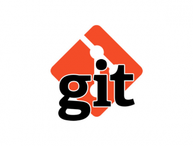

# Путедовдитель по Git

**Git** — это распределённая система контроля версий (VCS), используемая для отслеживания изменений в коде и совместной работы над проектами. Git позволяет разработчикам эффективно управлять своим исходным кодом, вести историю изменений, восстанавливать предыдущие версии и работать в команде.


# как начать работу с Git
### Установка Git

Для начала работы скачайте и установите Git на ваш компьютер. Это можно сделать с [официального сайта Git](https://git-scm.com/). Следуйте инструкциям установщика, чтобы настроить Git на вашей системе.

### Выберите редактор кода
В качестве редактора для работы с проектами отлично подойдёт Visual Studio Code (VS Code). Вы можете скачать его с [официального сайта VS Code](https://code.visualstudio.com/). После установки рекомендуется установить расширение для работы с Git, доступное в библиотеке расширений VS Code.

### Создайте директорию для проекта
Выберите место на вашем компьютере, где будет находиться ваш проект, и создайте папку. Например, назовите её gitHW1.

### Откройте терминал
Для работы с Git вам понадобится терминал. Если вы используете Windows, можно открыть командную строку (cmd):

* Нажмите `Win + R`, введите `cmd` и нажмите `Enter`.
* Перейдите в созданную папку: используйте команду `cd` для перехода в нужную директорию. Введите в терминале следующую команду:


```
cd путь_до_вашей_папки
``` 

Например, если папка называется gitHW1 и находится на рабочем столе, команда может выглядеть так:

```
cd C:\Users\Ваше_Имя\Desktop\gitHW1
```

Теперь вы готовы к следующему шагу — инициализации Git-репозитория! 🎉

# Основные команды Git

### 1. Инициализация репозитория
* git init

**Инициализирует новый локальный Git-репозиторий в текущей директории:**

```
C:\Users\User\Desktop\gitHW1>git init
```

### 2. Настройка пользователя

* git config
   * Имя: `git config --global user.name "Ваше Имя"`
   
    - Email: `git config --global user.email "your.email@example.com"`

**Настраивает параметры Git для конкретного пользователя, такие как имя и email**

```
C:\Users\User\Desktop\gitHW1>git config --global user.name "Ваше Имя"
```
```
C:\Users\User\Desktop\gitHW1>git config --global user.email "your.email@example.com" 
```
***Примечение :*** опция `--global` используется для изменения глобальных настроек Git, которые применяются ко всем репозиториям для текущего пользователя. 

опция `--local` указывает, что настройки или изменения будут применены только к текущему репозиторию. Этот уровень используется по умолчанию, если флаг не указан.

### 3. Проверка состояния репозитория
* git status

**Показывает текущее состояние репозитория (изменения, готовые к коммиту файлы и т.д.)**

```
C:\Users\User\Desktop\gitHW1>git status
```

### 4. Добавление изменений
* git add

**Добавляет файлы в область подготовленных изменений (staging area)**
```
C:\Users\User\Desktop\gitHW1>git add <имя_файла>
```

### 5. Фиксация изменений
* git commit 

**Фиксирует изменения в репозитории с комментарием**

```
C:\Users\User\Desktop\gitHW1>git commit -m "Сообщение о коммите"
```

### 6.  Просмотр истории коммитов
* git log

```
C:\Users\User\Desktop\gitHW1>git log
```
* Для краткого вывода используется опция `--online`:
```
C:\Users\User\Desktop\gitHW1>git log --oneline
```

### 7. Сравнение изменений
* git diff 
```
C:\Users\User\Desktop\gitHW1>git diff
```

### 8. Переключение между коммитами 
* git checkout 
```
C:\Users\User\Desktop\gitHW1>git checkout <имя_hash>
```
***Примечание*** : hash в Git — это уникальный код (из 40 символов), который создаётся для каждого коммита, файла или объекта. Он нужен, чтобы Git мог отслеживать изменения, сравнивать версии и гарантировать целостность данных. hash можно посмотреть командой `git log` и выглядит примерно так: `c796d7741d6cd2b3510930d817c9bd72b8e7ff41`

### 9. Отмена изменений в файле
* git restore
```
C:\Users\User\Desktop\gitHW1>git restore имя_файла
```
### 10. Создание ветки
* git branch <имя_ветки>
```
C:\Users\User\Desktop\gitHW1>git branch new_branch
```

### 11. Удаление ветки
* git branch -d <имя_ветки>
```
C:\Users\User\Desktop\gitHW1>git branch -d new_branch
```
### 12. Cлияние веток
Команда `git merge` объединяет изменения из одной ветки **--->** в другую. Чаще всего её используют для слияния фич или исправлений из рабочей ветки в основную (*main* или *master*).

* git merge <название ветки>

```sh
C:\Users\User\Desktop\gitHW1>git merge option_oneline
```


### 12. Опция Oneline
Опция `--oneline` в **Git** сокращает вывод команды `git log`, отображая каждый коммит в одну строку.

* git log --oneline

```sh
C:\Users\User\Desktop\gitHW1>git log --oneline
```
### пример результата:
```3e7a1b2 Добавил новую форму обратной связи
8f6d3c9 Исправил баг с авторизацией
a2c4d7e Обновил стили для главной страницы
4f9e2b8 Добавил API для поиска
1a5d3e7 Инициализация проекта
```
### 12. Опция Graph

Опция `--graph` в __Git__ визуализирует дерево коммитов и веток в виде текстового графа. Она показывает структуру слияний и разветвлений, помогая понять историю проекта.
* git log --graph
```sh
C:\Users\User\Desktop\gitHW1>git log --graph
```
### 13. Копируем удалённый репозиторий
Копирует удалённый репозиторий на ваш компьютер. Это создание полной копии проекта.
* git clone <url>
```sh
git clone https://github.com/ukkola-gorbusha/version_control.git
```

### 14. Отправляем изменения из локального репозитория в удалённый
Это команда для "загрузки" коммитов.
* git push <remote> <branch>
 
   * <remote> — имя удалённого репозитория (обычно origin).
   * <branch> — имя ветки (например, main или master).
```sh
git push origin main
```
__*Объяснение*__ :
Ваши изменения из локальной ветки **main** отправляются в удалённый репозиторий.

### 15. Отправляем изменения из локального репозитория в удалённый, И удаляем ветку.
```sh
git push origin main --delete newbranch
```

### 16. Загружаем изменения из удалённого репозитория
Загружает изменения из удалённого репозитория и автоматически сливает их с текущей веткой. Это "загрузка" и "обновление".
* git pull <remote> <branch> 
   * <remote> — имя удалённого репозитория.
   * <branch> — ветка, из которой нужно загрузить изменения.

```sh
git pull origin main
```

__*Объяснение*__:
Изменения из удалённой ветки `main` загрузятся и применятся к вашей текущей локальной ветке.


# About 

### Несколько цитат о Git
>**Git** — это ваша машина времени в мире кода: ошиблись? Просто вернитесь назад
  >>Работая с **Git**, вы никогда не теряете историю — только создаёте её.
  >>**Git** — это ваш лучший друг, когда всё идёт не так, как 
планировалось
  >>Не бойтесь экспериментировать: с **Git** любой шаг можно отменить



