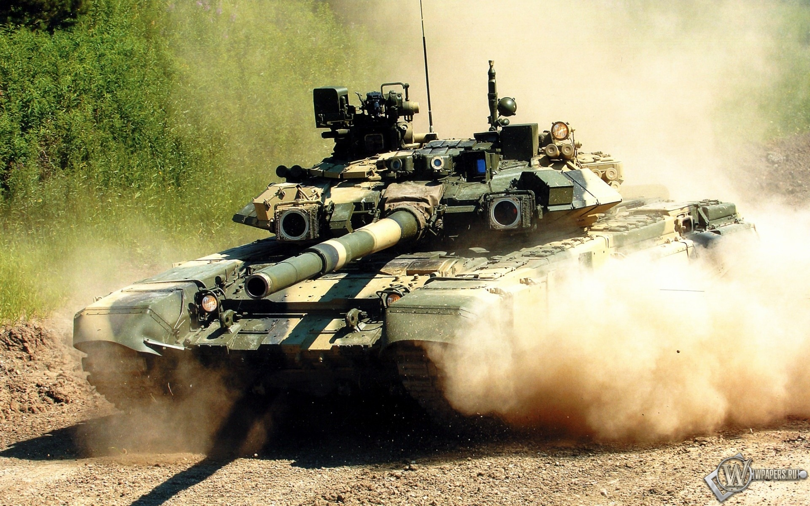

# Инструкция по языку MarkDown

## Стилизация текста
Обычный текст набираем как есть.

Новая строка.

**Полужирный текст**

*Курсив*

## Цитирование в языке MarkDown
>Первый уровенб цитирования
>>Второй уровень цитирования

## Списки
### Ненумерованный список
* Лист 1
* Лист 2

## Нумерованный список
1. Лист 1
2. Лист 2

## Web ссылки
Текст [пример ссылки](http.example.com "Всплывающая подсказка")

# Как добавлять картинки в MarkDown
Это танк
