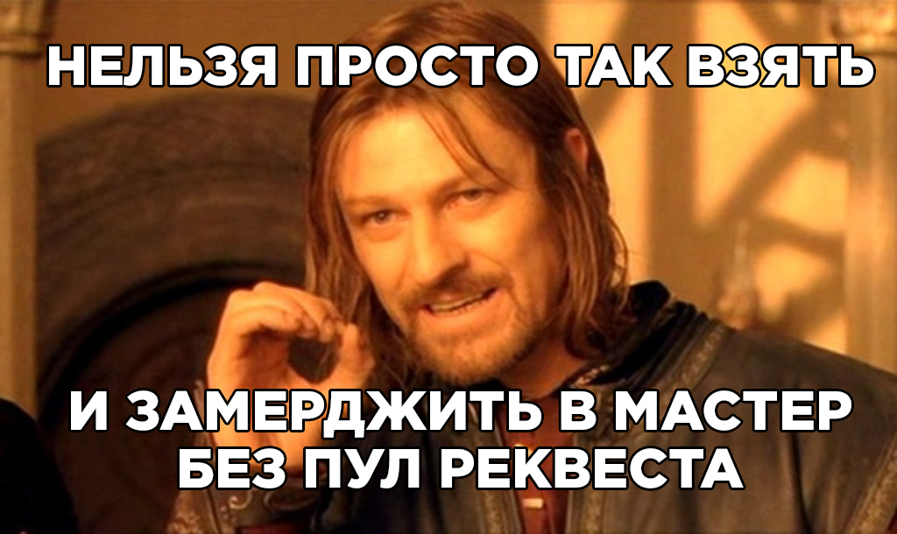

# Инструкция по языку MarkDown

## Заголовок 2-го уровня
### Заголовок 3-го уровня

Обычный текcт набираем как есть.

Новая строка.

**Полужирный текст**

*Курсив*

## Цитирование в языке MarkDown
> Первый уровень цитирования
>> Второй уровень

## Списки
### Ненумерованние списки
* Лист1
* Лист2
### Нумерованные списки
1. Лист 1
2. Лист 2

### WEB-ссылки
Текст [пример ссылки](http.example.com "Всплывающая подсказка")

## Как добавлять картинки в MarkDown
Это котик

